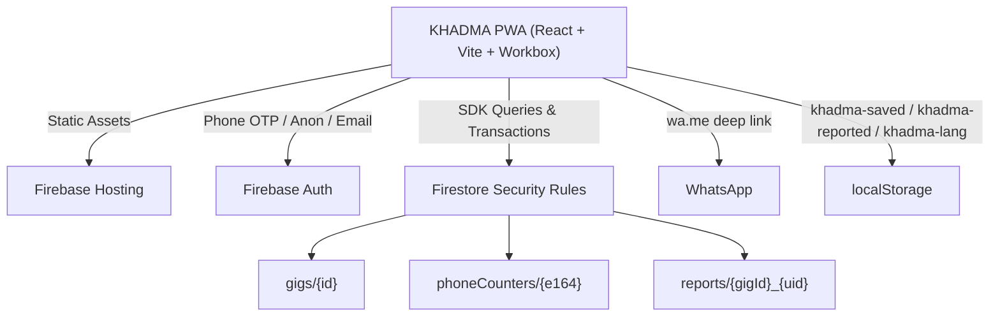

# Stage 01 — Architecture Audit

- **Mode:** Read-only (no application source files modified)
- **Target:** `Khadma-app` (`main` @ `8a01a9d` + 22 preserved uncommitted working-tree files)

## Executive Summary

KHADMA is a lean, mobile-first React + Vite PWA backed directly by Firebase Auth, Firestore, and Firebase Hosting, adhering 100% to the Google ecosystem stack policy in `AGENTS.md`. Recent uncommitted changes improved boundary hygiene (`Browse.tsx` now routes through `src/lib/db.ts`, `useAuth` centralizes auth hydration, and `ErrorBoundary` wraps `<Routes>`). Three architectural gaps remain open.

## System Topology

## Findings

| ID | Severity | Certainty | Affected Files | Summary & Recommendation |
|---|---|---|---|---|
| `ARCH-001` | Medium | CONFIRMED | `src/App.tsx:6-11` | **No route-level code splitting.** `Browse`, `GigDetail`, `PostGig`, `Saved`, `Settings`, and `Admin` are all statically imported into the initial bundle. Lazy-load `/admin`, `/post`, `/settings`, and `/saved` via `React.lazy` + `Suspense`. |
| `ARCH-002` | Medium | CONFIRMED | `src/pages/PostGig.tsx:41-106` | **Tight coupling to Firebase SMS OTP.** `AGENTS.md` mandates switching to WhatsApp verification if Algerian carriers (Mobilis/Djezzy/Ooredoo) drop SMS OTP. Extract phone verification into a dedicated `src/components/PhoneVerifier.tsx` / adapter boundary so the verification transport can be swapped without touching gig form logic. |
| `ARCH-003` | Low | CONFIRMED | `src/firebase.ts:7-14` | **No build/runtime guard for `VITE_FIREBASE_API_KEY`.** If `.env` is missing at build time, `apiKey` silently becomes `undefined` and fails cryptically at runtime. Add an explicit dev/startup assertion when `VITE_FIREBASE_API_KEY` is empty. |

## Coverage Manifest

- **Inspected:** All 26 source/config files (`src/**`, `firebase.json`, `firestore.rules`, `firestore.indexes.json`, `vite.config.ts`, `tsconfig.json`, `index.html`, `package.json`, `AGENTS.md`, `README.md`).
- **Not Verified:** Live Firebase Console project settings (Auth providers, SMS region policy, Blaze budget alerts).
